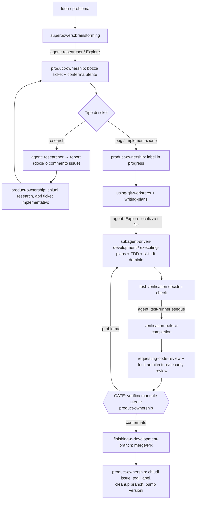

# Workflow end-to-end skills + agents (ticket #4)

Report di ricerca per l'issue [#4](https://github.com/alessiogarifo92/claude-skills/issues/4):
mappatura del ciclo di vita di un task sulle skill del repo, sulle skill del
plugin superpowers e sui custom agents, con analisi di gap/sovrapposizioni e
proposta di intervento minimo.

## Contesto

Il repo contiene 19 skill proprie più 3 custom agents (`agents/Explore.md`,
`agents/researcher.md`, `agents/test-runner.md`, introdotti in `e9fc7a9`), e
convive con il plugin superpowers (v6.1.1) che copre il processo di sviluppo
(brainstorming → piani → esecuzione → review → chiusura branch).

Le skill superpowers si referenziano già esplicitamente a catena (verificato
nei rispettivi `SKILL.md`):

- `brainstorming` dichiara "writing-plans is the next step"
- `writing-plans` chiude con REQUIRED SUB-SKILL → `subagent-driven-development`
  (se i subagent sono disponibili) oppure `executing-plans`
- entrambe le skill di esecuzione chiudono con REQUIRED SUB-SKILL →
  `finishing-a-development-branch`

Le skill del repo (`product-ownership` in testa) **non sono agganciate** a
questa catena, e i tre custom agents non sono nominati da nessuna skill.

## Obiettivo

Definire chi fa cosa in ogni fase (skill di processo, skill di dominio,
agent) e dove avviene il passaggio di consegne, senza riscrivere le skill
esistenti.

## Mappa fasi → skill → agents

| Fase | Skill di processo | Skill di supporto/dominio | Agent |
|---|---|---|---|
| 0. Principi operativi | `principal-engineering-core` (task non banali) | — | — |
| 1. Ideazione | `superpowers:brainstorming` | `brand-strategist`, `product-marketing-strategist` se il task è di prodotto/naming | `researcher` per feasibility check su fatti esterni; `Explore` per capire cosa esiste già nel codice |
| 2. Grounding / ticket | `product-ownership` (tipo di ticket, bozza + conferma utente, label esistenti) | `docs-and-specs` se il ticket nasce da una spec | `researcher` per le fonti esterne del ticket; `Explore` per verificare nel codice che il problema sia dove si pensa |
| 3. Presa in carico | `product-ownership` (label `in progress`), `superpowers:using-git-worktrees`, `superpowers:writing-plans` (task multi-step) | `refactoring-strategy` se il piano è un refactor | `Explore` per localizzare i file critici prima del piano; agent built-in `Plan` opzionale |
| 4a. Implementazione (ticket bug/feature) | `superpowers:subagent-driven-development` (preferita, i subagent sono disponibili) o `superpowers:executing-plans`; `superpowers:test-driven-development` per ogni task | skill di dominio: `laravel-architecture`, `vue-frontend`, `python-backend`, `go-backend`, `api-design`, `database-design`, `sql-performance`; se emerge un bug: `superpowers:systematic-debugging` + `debugging-workflow` | subagent implementatori orchestrati da subagent-driven-development; `Explore` per ricerche puntuali |
| 4b. Implementazione (ticket research) | `product-ownership` (il deliverable è un report, non codice) | `docs-and-specs` per la struttura del report | `researcher` produce i fatti verificati con fonti |
| 5. Verifica | `test-verification` (decide *cosa* eseguire) → `superpowers:verification-before-completion` (impone l'evidenza prima di dichiarare "fatto") | `handling-sudo-and-missing-tools` se l'ambiente blocca i comandi | `test-runner` esegue suite/lint/typecheck e riporta solo l'esito |
| 6. Review | `superpowers:requesting-code-review`; `superpowers:receiving-code-review` per gestire i feedback | lenti specializzate: `architecture-review` (cambi strutturali), `security-review` (trust boundaries) | reviewer subagent (template di requesting-code-review) |
| 7. Chiusura | **gate manuale utente di `product-ownership`** → `superpowers:finishing-a-development-branch` (opzioni merge/PR) → `product-ownership` (chiusura issue con SHA, rimozione label, cleanup branch locale+remoto, bump versione skill se modificate) | — | — |

Per i ticket research la fase 5–7 collassa in: report consegnato → chiusura
del ticket research → apertura di un ticket implementativo separato che lo
referenzia (regola già presente in `product-ownership`).

## Diagramma

## Gap e sovrapposizioni identificati

1. **Nessun punto unico documenta l'ordine.** La catena superpowers è
   auto-referenziata, ma l'ingresso (`product-ownership` fase 2–3) e l'uscita
   (gate manuale + chiusura issue, fase 7) vivono solo nella skill del repo,
   che la catena superpowers non conosce.
2. **Handoff chiusura non ordinato.** `finishing-a-development-branch`
   propone merge/PR; `product-ownership` impone il gate manuale dell'utente
   *prima* di qualsiasi push/merge. L'ordine corretto (gate → finishing →
   chiusura issue) non è scritto in nessuna delle due.
3. **Sovrapposizione debugging.** `debugging-workflow` (repo) e
   `superpowers:systematic-debugging` hanno trigger quasi identici. In
   pratica: systematic-debugging governa il processo (viene prima, per la
   regola "process skills first"), debugging-workflow aggiunge la variante
   repo. Le description non lo dicono.
4. **Complementarità verifica non dichiarata.** `test-verification` (scelta
   dei check) e `superpowers:verification-before-completion` (obbligo di
   evidenza) sembrano sovrapposte dalle description ma sono complementari:
   una sceglie, l'altra impone.
5. **Gli agents sono orfani.** Nessuna skill nomina i tre custom agents:
   `researcher` è pensato per i research ticket che `product-ownership`
   definisce ma non lo cita; `test-runner` è il braccio esecutivo di
   `test-verification` ma non è citato; `Explore` è utile in fase di
   grounding e pianificazione ma nessuna skill lo suggerisce.

## Opzioni valutate

- **A. Skill indice/orchestratore nuova** (`task-lifecycle`): documenta fasi,
  handoff e agents in un posto solo. Contro: aggiunge una skill che rischia
  di non essere invocata (il problema che dovrebbe risolvere), e duplica
  contenuti di `product-ownership`.
- **B. Solo migliorare le description esistenti.** Pro: zero nuove skill.
  Contro: le description sono righe singole — non c'è spazio per una tabella
  di handoff; il workflow resterebbe non documentato.
- **C. Estendere `product-ownership` + micro-ritocchi mirati.**
  `product-ownership` è già l'orchestratore naturale: è l'unica skill
  invocata sia all'inizio (ticket/presa in carico) sia alla fine (gate,
  chiusura, cleanup) del ciclo. Aggiungerle una sezione "Workflow end-to-end"
  con la tabella fasi → skill → agent chiude il gap 1, 2 e 5 senza creare
  nuove skill.

## Decisione proposta

**Opzione C.** Interventi, tutti minimi e da fare in un ticket implementativo
separato:

1. `product-ownership` — nuova sezione "Workflow end-to-end e handoff" con la
   tabella e il diagramma di questo report (o un riferimento a questo file),
   incluso l'ordine esplicito del gate di chiusura: gate manuale →
   `finishing-a-development-branch` → chiusura issue/cleanup. Nomina
   esplicitamente `researcher` (ticket research), `Explore` (grounding) e
   `test-runner` (verifica). Include le regole anti-attrito dalla sezione
   "Rischi e soluzioni": batching delle conferme in un unico punto di stop,
   formato autosufficiente dell'handoff al gate, e nuova riga di checklist
   sul sync della sezione quando si aggiungono/rinominano skill o agent.
   Bump MINOR → 1.1.0.
2. `debugging-workflow` — una riga nel body: "usa prima
   `superpowers:systematic-debugging` per il processo; questa skill aggiunge
   le regole repo-specifiche". Bump PATCH → 1.0.1.
3. `test-verification` — una riga: "delega l'esecuzione all'agent
   `test-runner` per tenere i log fuori dalla conversazione; questa skill
   decide *cosa* eseguire". Bump PATCH → 1.0.1.
4. `agents/researcher.md` — (opzionale) una riga che ricorda che alla
   consegna del report si applica la regola di chiusura research di
   `product-ownership`.
5. Questo report — nota in testa "Storico della decisione — la fonte di
   verità operativa è `product-ownership` § Workflow end-to-end", da
   aggiungere nello stesso commit che introduce la sezione.

## Rischi e soluzioni

Ogni rischio ha una soluzione operativa che entra nel ticket implementativo,
in modo che il workflow non abbia punti di attrito lasciati alla memoria.

1. **Sezione workflow fuori sync quando si aggiungono skill/agent.**
   Soluzione su due livelli:
   - la tabella resta al livello delle fasi (stabili) e non elenca
     esaustivamente le skill di dominio — si cita "skill di dominio
     pertinente" come categoria;
   - si aggiunge una riga alla checklist "Check" di `product-ownership`:
     *"Aggiunta o rinominata una skill o un agent del repo → la sezione
     Workflow end-to-end è ancora corretta? Aggiornala nello stesso commit."*
     La checklist viene già ripercorsa a ogni inizio/fine lavoro su ticket,
     quindi il sync viaggia sul meccanismo esistente invece di richiedere
     disciplina extra.

2. **Duplicazione tra questo report e la futura sezione.** Il report viene
   trattato come decision record immutabile (stile ADR): riceve in testa la
   nota *"Storico della decisione — la fonte di verità operativa è
   `product-ownership` § Workflow end-to-end"* e non viene più aggiornato.
   Un solo posto evolve, l'altro documenta il perché.

3. **Riferimenti agli agents per nome che diventano stali** (rinomina di
   `agents/*.md` non riflessa nelle skill che li citano). Coperto dalla
   stessa riga di checklist del punto 1, che include esplicitamente gli
   agent oltre alle skill.

4. **Punti di stop multipli che frammentano il flusso.** Il ciclo prevede
   per design tre conferme utente (bozza ticket, gate manuale pre-push,
   creazione ticket follow-up): se arrivano in momenti diversi, ogni assenza
   dell'utente blocca il lavoro tre volte. Soluzione: regola esplicita nella
   sezione workflow — *quando più conferme sono prevedibili, prepara tutto il
   materiale (report, bozze, testo di chiusura) e presenta le richieste in un
   unico punto di stop*, così una sola risposta sblocca l'intera coda. Il
   gate manuale resta invariato nel contenuto: cambia solo il batching.

5. **Gate manuale come collo di bottiglia cieco.** Se il messaggio al gate
   non è autosufficiente, l'utente deve ricostruire il contesto e il flusso
   si spezza. Soluzione: la sezione workflow ribadisce che il messaggio di
   handoff al gate deve essere completo in sé (cosa verificare, dove, esito
   atteso, cosa succederà dopo la conferma) — requisito già implicito in
   `product-ownership`, reso esplicito come formato dell'handoff.

## Verifica

- Il ticket implementativo derivato tocca solo i 3–4 file elencati, con bump
  versione + riga CHANGELOG nello stesso commit (regola di versioning già in
  vigore).
- Prova pratica: alla prossima presa in carico di un ticket, l'ordine delle
  skill invocate deve emergere dalla sezione workflow senza che l'utente lo
  debba dettare.
